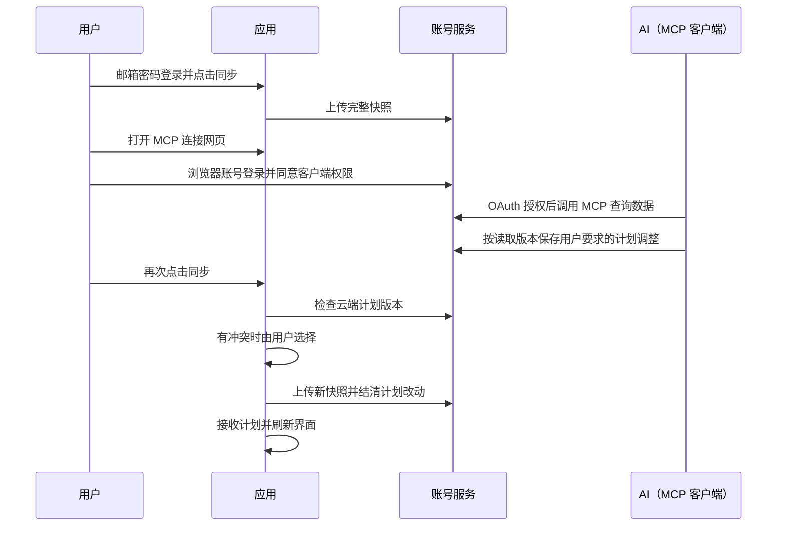

# 账号与手动同步

账号使用邮箱和密码，由分享服务中的 Better Auth 提供认证。设置 → 账号与同步支持注册、登录、手动同步和打开 MCP 连接网页；核心训练功能仍可离线使用。

| 操作 | 行为 |
| --- | --- |
| 注册或登录 | 密码至少 10 字符；应用保存登录令牌，不保存密码；当前不发送邮箱验证及找回邮件 |
| 首次同步 | 上传当前设备的完整备份，范围与本地全量导出一致 |
| 后续同步 | 读取云端计划，检查本地与云端版本，上传当前设备数据并在本地接收计划修改 |
| 从云端恢复全部数据 | 换设备登录后手动选择；预览快照时间及记录数量，确认后覆盖本机全部训练数据和备份设置，计划采用云端最新版本；不上传、不合并历史 |
| 计划冲突 | 选择保留本机或采用云端的整套计划和循环日程，不逐字段自动合并 |
| 上传中断 | 在本机保留待完成操作；用户再次同步时重试同一操作 ID，成功后结清；期间新增记录可随后再次同步上传 |
| 退出 | 撤销当前会话并移除本机令牌，保留本地训练数据 |
| 连接 AI（MCP） | 新标签页打开同一服务地址的 `/mcp` 网页，按照客户端说明连接，并在浏览器使用 Represt 账号完成 OAuth 授权；链接不携带账号凭证 |
| 云端数据概览 | 应用签发 1 分钟有效、仅可兑换一次的跳转票据，新标签页自动沿用当前账号；票据位于 URL fragment，进入后立即清除；独立打开支持账号登录 |
| 导入全量文件 | 恢复原有备份数据，同时清除旧同步基线，避免把旧操作自动上传 |

| 数据或权限 | 规则 |
| --- | --- |
| 本机数据库 | 版本 19 增加 `accountSync` 表，保存比较基线及待完成操作；不进入备份文件 |
| 服务地址 | 复用 `VITE_PLAN_SHARE_API_BASE_URL`；生产默认 `https://share.represt.app` |
| AI 入口 | `/mcp` 网页提供客户端连接说明；工具契约见 [MCP 架构](../mcp-server/docs/architecture.md)，统计口径见 [聚合查询](../mcp-server/docs/analytics.md) |
| AI 修改 | `/api/account/plans` 仅修改计划和循环日程；训练历史不会随计划调整而改写 |
| AI 权限 | `training:read` 读取训练数据；`plans:write` 允许计划及循环编辑。OAuth 凭证由客户端管理；每次请求复核会话和授权 |
| 账号权限 | 邮箱密码用于应用、可视化页和 OAuth 登录；密码不交给 AI。应用登录不会自动授权 MCP 客户端 |
| 训练历史 | 同步上传本机历史；云端恢复明确覆盖本机历史，不合并多设备记录。恢复前再次校验云端版本，所有表与同步基线在同一事务内更新，失败则整体回滚 |
| 容量 | 同步请求最多 10 MiB，计划写请求最多 256 KiB；超限不覆盖现有数据 |
| 隐私 | 密码、账号会话与 OAuth 凭证不进入 URL 或备份；数据概览跳转仅携带短期单次票据；私有响应使用 `no-store`；恢复保留当前账号会话，清除训练中的运行状态 |

前端验证：`npm test`、`npm run build`、`npm run lint`。后端资源与发布操作见 Worker 仓库中的 `ACCOUNT_SYNC.md`；前端上线前需要完成后端配置。

设置页与 AI 导入页共用账号弹层；设置项通过 `SettingsRow` 的图标、标题、副标题、右侧内容和点击回调渲染，沿用现有图标容器与行布局。
