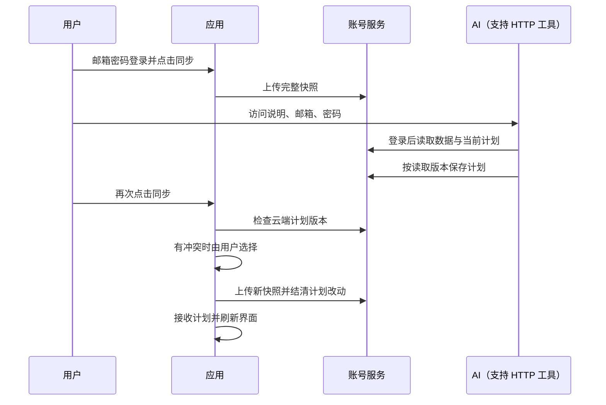

# 账号与手动同步

账号使用邮箱和密码，由分享服务中的 Better Auth 提供认证。设置 → 账号与同步支持注册、登录、手动同步和复制 AI 访问说明；核心训练功能仍可离线使用。

| 操作 | 行为 |
| --- | --- |
| 注册或登录 | 密码至少 10 字符；应用保存登录令牌，不保存密码；当前不发送邮箱验证及找回邮件 |
| 首次同步 | 上传当前设备的完整备份，范围与本地全量导出一致 |
| 后续同步 | 读取云端计划，检查本地与云端版本，上传当前设备数据并在本地接收计划修改 |
| 计划冲突 | 选择保留本机或采用云端的整套计划和循环日程，不逐字段自动合并 |
| 上传中断 | 在本机保留待完成操作；用户再次同步时重试同一操作 ID，成功后结清；期间新增记录可随后再次同步上传 |
| 退出 | 撤销当前会话并移除本机令牌，保留本地训练数据 |
| 导入全量文件 | 恢复原有备份数据，同时清除旧同步基线，避免把旧操作自动上传 |

| 数据或权限 | 规则 |
| --- | --- |
| 本机数据库 | 版本 19 增加 `accountSync` 表，保存比较基线及待完成操作；不进入备份文件 |
| 服务地址 | 复用 `VITE_PLAN_SHARE_API_BASE_URL`；生产默认 `https://share.represt.app` |
| AI 入口 | `/api/account/guide` 提供登录方法、读取接口、计划格式、字段单位和版本规则 |
| AI 修改 | `/api/account/plans` 仅修改计划和循环日程；训练历史不会随计划调整而改写 |
| 共享账号 | 使用同一账号密码的访问者拥有相同账号权限，包括调用全量上传接口；接口说明不能替代权限隔离 |
| 训练历史 | 手动上传到云端，不从云端覆盖本机；本功能不合并多设备历史记录 |
| 容量 | 同步请求最多 10 MiB，计划写请求最多 256 KiB；超限不覆盖现有数据 |
| 隐私 | 密码与令牌不进入 URL 或备份；私有响应使用 `no-store`；只有主动点击才传输训练数据 |

前端验证：`npm test`、`npm run build`、`npm run lint`。后端资源与发布操作见 Worker 仓库中的 `ACCOUNT_SYNC.md`；前端上线前需要完成后端配置。
