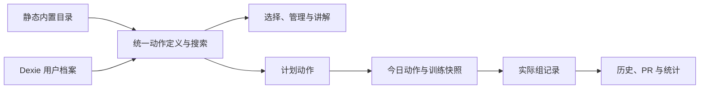

# 动作数据与身份

| 数据 | 当前职责 |
| --- | --- |
| 内置目录 | 静态发布的 126 个动作；保留 93 个原有标识，33 个补充动作使用 `oedb:` 命名空间 |
| `exerciseProfiles` | 自定义定义、内置隐藏状态与已保存的个人覆盖；不复制整套内置库 |
| `exerciseProfileId` | 计划、今日动作、训练快照及实际组记录共享的稳定引用；自定义改名不改变引用 |
| 名称 | 内置名称来自 i18n；计划与训练保存各自名称快照，自定义历史名称不随改名批量重写 |
| 分类 | 主次肌群、层级肌群、主要器械、辅助设施、动作模式、复合/孤立和单双侧；粗肌群比例单独用于统计记账 |
| 负重语义 | `external`、`bodyweight`、`assisted`、`variable`；实际组保存当时语义，辅助重量和非标准阻力不计普通重量 PR 与吨位 |
| 默认参数 | 仅在新增动作时应用组数与休息；次数范围和重量增量为提示，不回填实际记录、不自动加重 |
| 文字讲解 | 从训练页和动作记录进入 `/exercise-guide/:profileId`；随应用离线发布；缺少中文讲解时明确显示英文回退 |

| 操作或协议 | 当前规则 |
| --- | --- |
| 内置管理 | 只读，可复制、隐藏和恢复；既有覆盖只读保留，可重置，重置保留隐藏状态 |
| 自定义管理 | 新身份为 `custom:<UUID>`；旧名称型身份作为稳定 ID 保留；同名可共存，归档不删除记录 |
| 复制 | 创建独立身份，保存来源和讲解文本；不替换计划引用，不继承原动作 PR |
| Dexie | 版本 22；冻结的 v21 名称/目录规则负责旧记录归组，扩库不会接管旧自定义动作 |
| 备份 | schemaVersion 2，可恢复 v1；恢复在事务中归一化引用，保留实际数值和记录 ID |
| 分享 | 外层 schemaVersion 2、内容 formatVersion 2；包含引用和所需自定义元数据；同名不覆盖，重复导入复用相同来源定义 |
| 账号同步 | 服务端声明 `supportedDataSchemaVersion: 2`；已有 v2 快照后拒绝 v1 覆盖；待重试操作保留原始内容和操作 ID |
| MCP | 支持 v1/v2 快照、新引用与负重语义；构建时从应用目录生成统计所需的目录子集 |

上游维护流程见[目录维护](../tools/exercise-catalog-editor/README.md)，逐条作者、许可与来源保存在生成数据的 `provenance`，汇总见[数据署名](../src/domain/exercise-catalog/ATTRIBUTION.md)。
