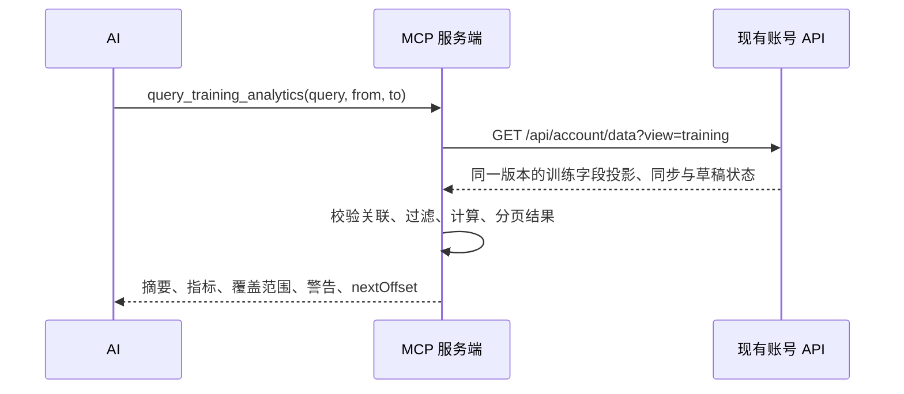

# 训练聚合查询契约

`query_training_analytics` 在 MCP 服务端读取同一版本的完整同步快照，关联、筛选和计算后返回摘要。权限为 `training:read`，用户身份完全来自现有 OAuth；不接受用户 ID 或上游地址，不写训练数据。当前计划和循环仍由 `get_training_program` 提供。



| 查询 `query` | 返回的 `items` | 用途与口径 |
| --- | --- | --- |
| `workout_summary` | 按日期倒序的会话、历史目标、实际动作与全部逐组明细、上次同类训练 | “今天练得如何”首选；完成率按历史计划项逐项封顶，额外组数不抵扣未完成动作；无需先读指南或完整计划 |
| `overview` | 空数组；指标在 `summary` | 有完成组的会话数、训练日数、动作数、空会话数、各项总量；计划目标另列于 `planned`，覆盖所选会话全部计划项，不随动作/肌群过滤缩小 |
| `history` | 按训练日倒序的实际会话，含各动作摘要和单组最佳成绩 | 上次练腿、今天实际做了什么；使用 `muscleGroup` / `sessionId` 筛选，只列实际完成的动作 |
| `exercise_progress` | 每个训练日的动作指标和单组最佳成绩 | 必传 `exerciseKey` 或 `exerciseName`；系列摘要含首末值、差值、百分比，少于两个有效训练日不比较 |
| `frequency` | 含零记录桶的日/周/月统计 | 训练会话数、训练日数、间隔均值、总体标准差和变异系数；少于两个间隔或两个完整桶时报告样本不足 |
| `volume` | 日/周/月、动作身份和计量类型的分组 | 分别返回次数、时长、距离、重量×次数、重量×距离；只列有记录的桶 |
| `muscle_distribution` | 日/周/月内各肌群的加权组数、占比、加权指标 | 按档案或目录的肌群比例分配；未知分类单列 `unknown`，只列有记录的桶 |
| `personal_records` | 各动作各类单组最佳值及对应记录 ID、训练日、时间 | 仅为指定范围内最佳；查询全历史范围才可称为已同步历史中的个人纪录；并列取完成时间较晚者 |
| `plateaus` | 符合停滞筛查条件的动作系列 | 至少 `minTrainingDays` 个有效训练日，观察跨度至少 `minSpanDays`；后续任何训练日的主要指标最佳值均未超过首日才入选 |

| 参数 | 契约 |
| --- | --- |
| `version` | 首次查询可省略，直接取得当前版本；后续分页必须传入首次返回的版本。云端计划编辑也会增加版本，历史快照内容可以保持不变 |
| `compare` | 默认 `none`；`previous_period` 在同次调用内计算紧邻的等长前一日期范围，返回该范围的汇总和指标差值；动作/肌群过滤一致，`sessionId` 仅限定当前范围 |
| `from` / `to` | 必填，包含首尾的本地 `sessionDateKey`；真实日历日期，年份 0001–9998，跨度最多 3660 天。服务端不猜测“今天”的用户时区 |
| `bucket` | `day` / `week` / `month`，默认 `week`；日历周从周一开始，边界桶标注 `partial`，`from/to` 给出实际交集 |
| `exerciseKey` | 工具结果中的稳定分组键：`catalog:ID`，没有目录 ID 时为 `name:规范化名称`，名称空时退回实例 ID |
| `exerciseName` | 与 `exerciseKey` 二选一；按 NFKC、大小写及空白规范化后的精确名称查询，不作模糊匹配。同名对应多个身份时返回 `AMBIGUOUS_EXERCISE` |
| `muscleGroup` | 可选；筛选已知分类中包含该肌群的完成组。未知分类不匹配；所选组仍按完整分布分配，其他参与肌群会同时返回 |
| `sessionId` | 可选；只筛选当前用户快照内该会话的实际记录 |
| `offset` / `limit` | 默认 0 / 50，单页最多 100 项；计算全部匹配记录后分页。沿用全部参数和版本，跟随 `nextOffset` 直到 null |
| `minTrainingDays` / `minSpanDays` | 仅影响停滞筛查，默认 3 个有效训练日 / 21 天跨度；分别支持 3–100 / 1–3660 |

调用示例：

```json
{
  "query": "workout_summary",
  "from": "2026-10-26",
  "to": "2026-10-26"
}
```

## 数据与指标口径

| 项目 | 规则 |
| --- | --- |
| 训练证据 | `setRecords` 表示完成一组；必须具有有效完成时间，关联到同一会话内的 `performedExercises` 和有效本地训练日。计数不依赖 `completedSets` 缓存，不表示整个计划已完成 |
| 计划与历史 | `sessionPlanItems` 的已知目标只列为计划指标；实际成绩只读组记录。历史动作名称、目录 ID、计量类型来自 performed exercise / sourcePlanSnapshot，不以当前计划覆盖历史 |
| 摘要完成率 | `creditedSets / knownTargetSets`，每项计入组数最多为该项目标；目标缺失、不完整或总目标为零时为 null。未关联计划项的组另计 `unplannedSets`；`planItems` 包括零完成项，`exercises` 仅包括有实际组的动作 |
| 同类训练 | 优先相同 `plannedPlanId`；缺少计划 ID 时要求实际动作身份和计量类型集合完全一致。取严格早于当前训练日的最近有实际组会话；不以空会话、未来训练或计划名称作为对比。无候选时 `previous=null`，动作增删分别返回 null 或 `removedExercises` |
| 计量类型来源 | 优先历史动作字段，再取历史 sourcePlanSnapshot、同步档案、目录 ID 对应类型；未知类型只计完成组，不猜数值意义。计量类型变化时分系列比较 |
| 单位 | `weightKg` 始终为 kg，界面 lb 偏好不改变存储值；`reps` 为次数，`durationSeconds` 为秒，`distanceMeters` 为米，`weightRepsKg` 为 kg×次数，`loadDistanceKgMeters` 为 kg×米 |
| 缺失指标 | null、未提供、负数、非有限数字和非整数次数不参与对应指标；不使用计划默认值补全。无有效观测时总量为 null，有效的零保留为 0；`observedSets` 表示各项有效观测组数 |
| 动作归并 | 相同目录 ID 合并，保留每条不同 ID 的完成组；无目录 ID 时按规范化名称合并。自定义动作改名可能形成两个系列；同名不同目录动作不会合并 |
| 肌群分类 | 同步档案优先，其次使用项目内置目录 ID 的分类；比例须为正且总和为 1，否则为未知。加权组数之和等于匹配完成组数；比例是模型估算，不能解释为精确生理刺激 |
| 肌群时间限制 | 数据模型没有历史每组肌群快照；档案分类反映最近同步时的设置，目录分类反映服务打包时的版本。相关限制会通过 warnings 返回 |
| 主要进步指标 | weightReps 看单组最高重量，reps 看最高次数，duration 看最长时长，distance 看最长距离，weightDistance 看最大单组重量×距离；同时返回其他单组最佳指标 |
| 筛查限制 | 停滞只表示本范围内主要指标未超过首日，不代表所有维度停滞。训练频率提供客观统计，不自动推断缺训、恢复、健康状态或稳定性阈值 |

## 响应与调用选择

工具沿用 `{ok, data?, error?}`；`data` 按 `query` 提供明确的输出 Schema。所有查询保留 `version`、`syncedAt`、备份 `schemaVersion`、`exportedAt`、请求日期范围，以及全量匹配的 `summary`、`coverage`。后端支持时还返回 `snapshotVersion` 和计划草稿 `pending`，`units` 明示指标单位。`total` 计算结果项总数，`nextOffset` 指向下一页；摘要不随分页变化。训练摘要按会话分页，单个会话内的组不会截断。

| 状态或反馈 | AI 的处理方式 |
| --- | --- |
| `ok` | 结合范围、同步时间和警告陈述观察结果；停滞筛查已满足样本条件但结果为空，表示没有匹配候选 |
| `no_matching_data` | 此范围/筛选没有关联有效的完成组；不能据此断言用户没训练 |
| `insufficient_history` | 趋势、频率或停滞筛查样本不足；不要断言已经进步或停滞 |
| `NO_DATA` / `SYNC_REQUIRED` | 没有同步快照或同步时间；请求用户在应用手动同步，不能将失败读为零训练 |
| `VERSION_CONFLICT` | 省略版本从第一页重新查询；不混合多个版本 |
| `INVALID_UPSTREAM_RESPONSE` | 快照结构、必需表、时间元数据或备份 schemaVersion 不受支持；不返回不完整成功结果 |
| 关联损坏、重复主键、格式错误 | 无法可信关联的记录保守排除，返回 warning；重复 ID 的所有冲突行排除，避免任取一行。诊断针对整个快照，筛选后的数据可能不涉及这些行 |
| 未同步活动 | 每次都有 `SYNC_SNAPSHOT_ONLY` 提示；`coverage` 给出整个快照首末实际训练日和本次匹配量，不代表未记录期间的真实活动 |
| 原始记录读取 | 摘要已覆盖逐组明细和计划完成率；聚合未覆盖的问题可由兼容接口 `read_training_history` 读取，同版本完整翻页 |

实现复用快照 API 的 `view=training`，只传五张训练表及分析字段，剔除完整计划、循环、设置、分享记录与重复动作快照字段。MCP 服务端建立关联并聚合，不做跨用户缓存；仅训练摘要携带所选会话及上次同类训练的逐组记录。R2 仍保存并读取原子完整快照，成本随快照大小增长，结果分页只限制输出。日期范围较长时可分段查询，但不能把分段最佳值当作完整的进步或停滞判断。

内置分类位于 `src/catalog.json`，由应用的 `src/domain/exercise-catalog/exercises.ts` 生成。在 MCP 目录执行 `node scripts/package-catalog.mjs` 更新打包分类；单元测试校验与应用源目录完全一致。运行时只读取打包 JSON，独立 Node 和 Worker 部署均不依赖浏览器模块。
