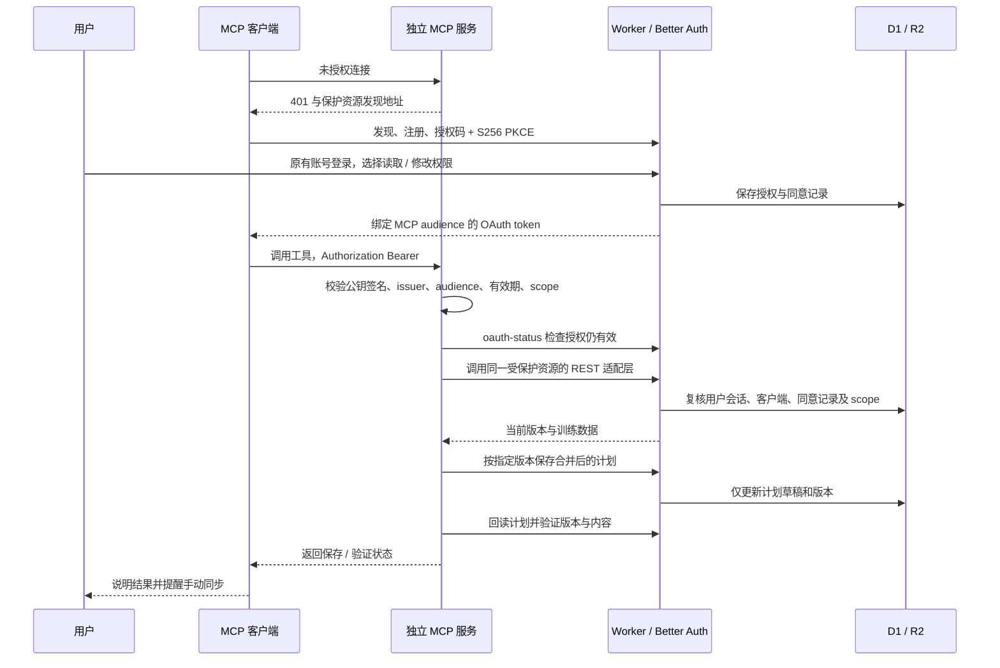

# MCP 架构与工具契约

| 层 | 实现与职责 |
| --- | --- |
| 本机应用 | React 19、Dexie、PWA / Capacitor；训练记录保存在设备，用户主动同步 |
| Represt Worker | Better Auth 邮箱密码登录；D1 保存账号、OAuth 授权和计划版本；私有 R2 保存完整同步快照 |
| OAuth Provider | 在现有 Better Auth 上增加官方 OAuth Provider 与 JWT 插件；复用账号、登录会话与数据库适配器；不创建第二套用户系统 |
| 独立 MCP 服务 | `@modelcontextprotocol/server@2.4.0`、Zod 和 JOSE；同一工具模块提供 Node HTTP 与独立 Cloudflare Worker 入口；不导入浏览器代码或读取 Dexie |
| 连接说明页 | 独立 MCP Worker 的 HTML GET 页面与插件配置包下载；不参与账号授权或凭证存储 |
| REST 适配层 | 固定上游的 `/api/account/guide`、`/plans`、`/data`、`/oauth-status`；复用版本校验、计划解析、R2 读取和认证逻辑 |
| 协议 | MCP `2026-07-28`，Streamable HTTP；SDK 同时提供 2025 客户端的无状态兼容入口，无需协议会话存储 |

| 安全边界 | 规则 |
| --- | --- |
| 单一受保护资源 | MCP 前端和 Worker 的受限 REST 适配层共同组成配置的 MCP resource；只接受本应用为该 audience 签发的 token，不接收外部 API token，不向其他服务转发凭证 |
| 用户隔离 | 用户 ID 由受信 OAuth 签名声明绑定，并与数据库会话核对；工具没有账号 ID、上游 URL 或自定义认证参数 |
| 读取权限 | `training:read` 允许读取当前计划、循环和所有已同步训练表 |
| 修改权限 | `training:read` + `plans:write` 只允许修改计划与循环；不能上传快照、修改训练历史、签发凭证或管理账号 |
| 持续授权 | `offline_access` 可选；短期 JWT + 轮换刷新令牌；客户端保存并刷新凭证，MCP 不保存 refresh token；凭证和密码不写源码、不进入业务日志或 URL |
| 客户端发现 | RFC 8414、RFC 9728、RFC 7591 DCR、RFC 8707 resource、RFC 9207 issuer、OAuth 授权码与 PKCE；DCR 受现有 Better Auth 限流保护 |
| 注册策略 | 启用 DCR 兼容 ChatGPT、Claude 和 Codex；本实现未声明 CIMD 支持，客户端通过发现到的注册端点注册；授权同意不能由客户端跳过 |
| 撤销 | 每次受保护 MCP 请求先复核会话、客户端禁用状态和同意，再处理协议；REST 业务请求再次检查；私有接口不缓存 |
| 用户意图 | 写工具要求明确指令和 `confirmedByUser=true`，并声明写入 / 破坏性标注供客户端确认；该字段表达调用方确认，不替代 OAuth 授权 |

| Tool | 输入 | 成功输出 `data` |
| --- | --- | --- |
| `get_training_program` | 空对象 | `version`、`syncedAt`、`pending`、`plans: {plans, cycle}`；包括全部计划与动作 ID |
| `query_training_analytics` | `query`、`from`、`to`；可选版本、对比、桶、筛选及分页 | 训练摘要含逐组明细、完成率和上次同类训练；统计和趋势共用此入口，见 [analytics.md](analytics.md) |
| `update_training_program` | `expectedVersion`、`userInstruction`、`confirmedByUser`；可选计划补丁、删除 ID、完整循环补丁 | 回读的当前计划与版本，以及 `saved`、`verified` |

默认 `tools/list` 仅展示上述三个工具。`get_training_guide` 和 `read_training_history` 保留注册与调用兼容；指南不再是分析前置调用。精确输入和输出 JSON Schema 由 Zod 生成，定义位于 `src/schemas.ts` 和 `src/analytics-schema.ts`；SDK 执行输入与输出校验。工具结果为 `{ok, data?, error?}`，失败同时标记 `isError=true`。性能日志和测量口径见 [performance.md](performance.md)。

| 数据约定 | 规则 |
| --- | --- |
| 完整历史 | 支持快照内全部九张业务表；每页 1–1000 条，不把第一页当作全部历史；一次读取序列固定 `version`，冲突后重新读取 |
| 时间与关联 | `from/to` 按用户本地 `sessionDateKey` 筛选训练日及其关联记录；通过 `sessionId`、`performedExerciseId`、`planItemId` 关联，不能仅凭名称或缺失记录推断训练 |
| 计划补丁 | 有 ID 时只更新该对象；无 ID 时创建 UUID；未提供的字段、计划、动作与循环保持原样；名称不自动改写 |
| 删除与排序 | 显式传入 `removePlanIds`、`removeExerciseIds`；排序必须包含该计划的全部动作 ID；存在循环引用的计划不能被隐式删除 |
| 循环 | 由 `slots`、`anchorDateKey`、`anchorIndex` 表示；空 `planId` 为休息日；尽可能匹配原 slot ID，新 slot 才创建 ID |
| 写入 | 先读最新计划，比较 `expectedVersion`，合并补丁后走现有 PUT；保存后立即 GET，比较写入版本与完整内容；不重建训练历史或改动历史快照 |
| 单位 | 重量 kg、次数 reps、时长与休息 s、距离 m；不混合不同测量类型的训练量 |

| 错误 / HTTP 状态 | 调用方处理 |
| --- | --- |
| 401 + `WWW-Authenticate` | 重新连接并授权 MCP；不索要账号密码，不让用户复制旧 HTTP 说明 |
| 403 `insufficient_scope` | 申请 `training:read plans:write` 后重走授权；只读 token 直接请求 REST 写入也被拒绝 |
| `VERSION_CONFLICT` | 重读版本并审查差异，不自动覆盖并发修改 |
| `NO_DATA` / `SYNC_REQUIRED` | 请用户先在应用同步 |
| `INVALID_CHANGE` / SDK 参数错误 | 修正不存在的 ID、循环引用、日期或字段，不盲目重试 |
| `WRITE_OUTCOME_UNKNOWN` | `saved=null, verified=false`；响应丢失，先读取现状再决定后续操作 |
| `READBACK_FAILED` / `READBACK_MISMATCH` | `saved=true, verified=false`；保存已成功但尚未验证，不能重复写入或声称已经核验 |

规范与组件依据：[MCP 授权规范](https://modelcontextprotocol.io/specification/2026-07-28/basic/authorization)、[MCP TypeScript SDK v2](https://ts.sdk.modelcontextprotocol.io/v2/)、[Better Auth OAuth Provider](https://better-auth.com/docs/plugins/oauth-provider)、[OpenAI MCP 授权](https://developers.openai.com/plugins/build/auth)。
