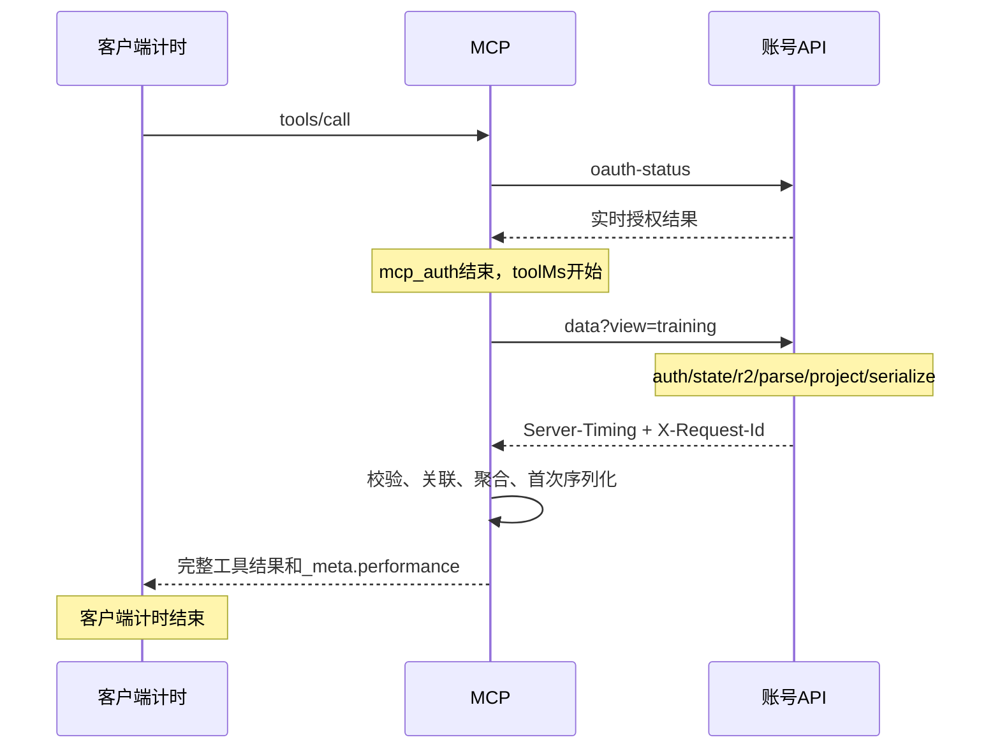

# MCP 性能测量约定

| 观测点 | 字段与解释 |
| --- | --- |
| 账号 API 响应头 | `Server-Timing` 包含 `auth`、`state`、`r2`、`parse`、`project`、`serialize` 和 `account`；后者是整个账号请求处理时间，其他项按实际路径出现 |
| 账号 API 日志 | `account_performance`：requestId、固定 pathname、HTTP 状态、serverMs、各阶段及响应字节数；不含查询参数、用户 ID、token、训练内容 |
| MCP 上游日志 | `mcp_upstream_performance`：关联账号 API 的 requestId、上游总耗时、upstreamServerMs；差值 `transportAndDecodeMs` 包括内部往返、排队、读取与 JSON 解码，不能解释为纯网络 RTT |
| MCP HTTP 响应头 | `mcp_auth` 为 JWT 和实时授权检查；`mcp_dispatch` 为返回协议 Response 的时间，流式响应可能尚未完成，不能单独当作工具完成时间 |
| MCP 工具结果 | `_meta.performance.toolMs` 为上游读取、聚合及首次结果序列化时间；`responseBytes` 为业务结果 UTF-8 字节数；`mcp_tool_performance` 日志提供相同字段 |
| 客户端观测 | 应计时到 MCP 工具结果完整接收，统计实际 HTTP body 字节。客户端总时间减去 `mcp_auth + toolMs` 得到协议、后续序列化、排队、传输、客户端解码等残余开销 |

在 `mcp-server` 执行 `npx tsx test/performance.ts`，报告写入 `.wrangler/performance-results.json`。脚本从两个仓库的 Git HEAD 重建基线到忽略目录，仅添加计时；不重置工作区、不访问生产账号。使用真实 OAuth PKCE、SDK Streamable HTTP、本地 Miniflare D1/R2；156 次训练、2808 组，预热一次后各测五次取中位数，`BENCH_REPEATS` 可覆盖次数。基线遵循旧 instructions，先读指南和计划；优化后直接读取聚合。OAuth 建连不计入测量，也不模拟公网或模型思考延迟。

正确性逐项核对今日及上次训练的全部组、历史目标、周对比总量和趋势桶；另外断言额外组不抵扣其他缺失组。性能回归无需固定毫秒阈值；关注调用次数、响应大小、相同数据与环境下的中位数。

R2 仍为原子快照，每个聚合查询读取解析一次完整对象，随后仅传输分析字段；大快照的成本仍需结合生产日志观察。默认不缓存私有快照或 OAuth 授权，不引入跨用户数据与撤销延迟。
